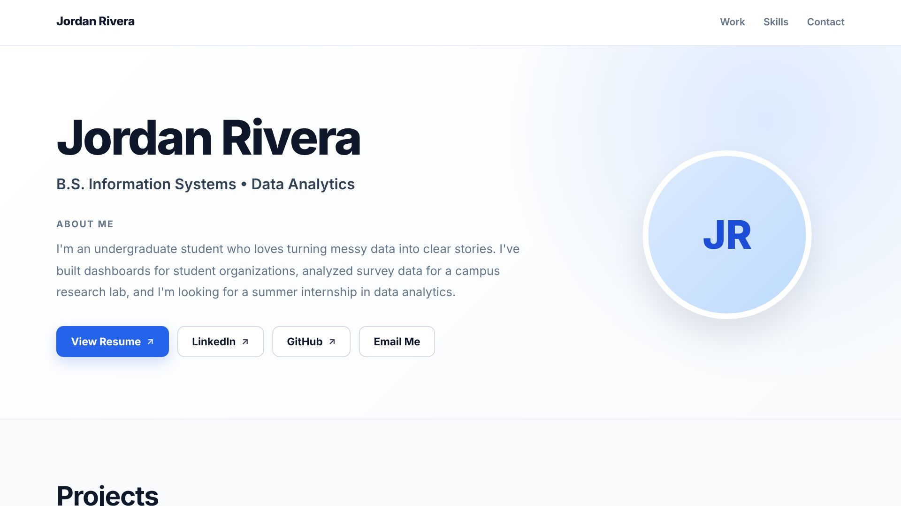
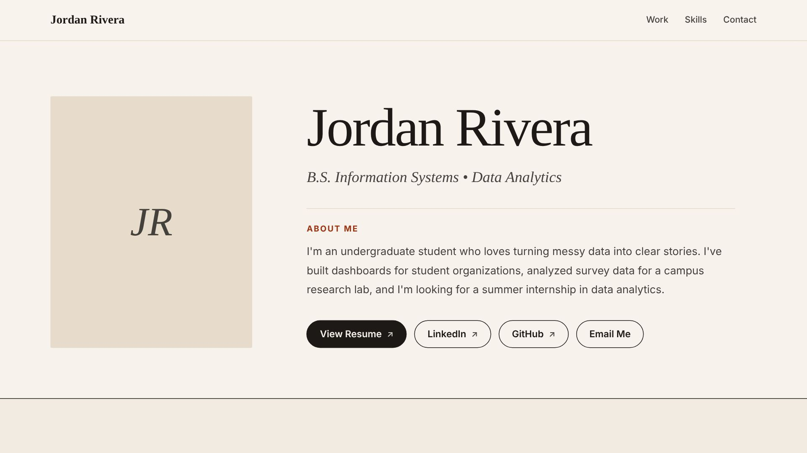
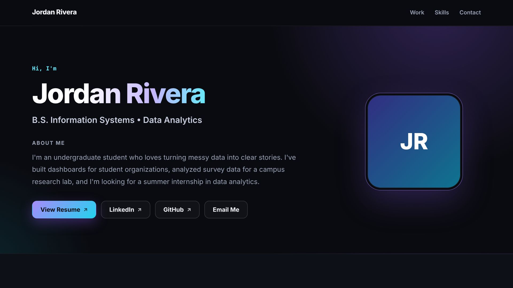
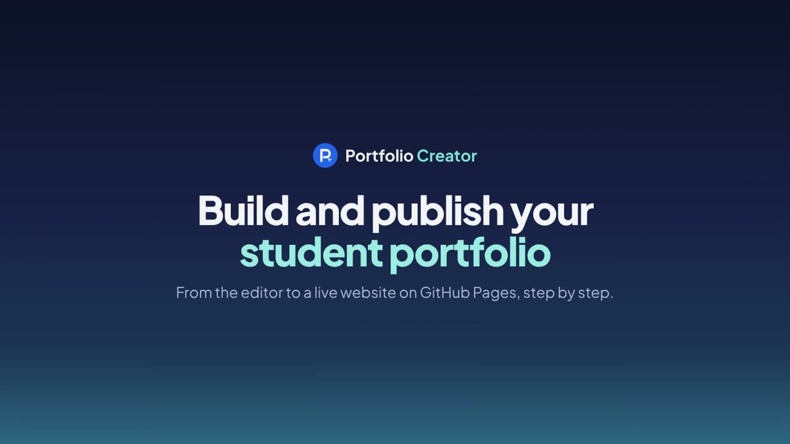

# Portfolio Creator

**A free, no-code tool that helps students build a personal portfolio website and publish it with GitHub Pages.**

**[Open Portfolio Creator →](https://anejdetbegdes-gif.github.io/portfolio-creator/)** · [Example portfolio](https://anejdetbegdes-gif.github.io/portfolio-creator/example.html) · [Step-by-step guide](https://anejdetbegdes-gif.github.io/portfolio-creator/guide.html)

Students fill in their information in the browser, preview the result on a laptop and a phone, and export one file, `index.html`. They upload that file to a GitHub repository and get their own link, such as `https://username.github.io/my-portfolio/`.

Plain HTML, CSS and JavaScript. No backend, accounts, database, frameworks, tracking or external services.

---

## Three portfolio designs

<table>
  <tr>
    <td align="center"><br><b>Professional Light</b></td>
    <td align="center"><br><b>Editorial Minimal</b></td>
    <td align="center"><br><b>Modern Dark</b></td>
  </tr>
</table>

Students can switch designs at any time and their content is kept.

## Video guide

[](https://anejdetbegdes-gif.github.io/portfolio-creator/guide.html)

A 2½-minute video, from the editor to a live website. It has no sound; the steps are shown on screen with captions. It plays at the top of the **Guide** page.

## How it works

1. **Customize:** add your name, photo, links, projects, experience, education, skills and certifications. Click **✎ Edit** and **+ Add**; no code is needed.
2. **Preview:** see exactly how the site looks on a laptop and on a phone.
3. **Export:** download one ready-to-publish file, `index.html`.
4. **Publish:** upload it to a GitHub repository, turn on GitHub Pages and share the link.

The **Guide** tab explains every step, including an introduction to GitHub for first-time users. A printable version with screenshots is included as PDF and Word.

## Pages

| Page | Purpose |
|---|---|
| `index.html` | Homepage: how it works, the three designs, FAQ |
| `creator.html` | The editor (works with `creator.js`) |
| `example.html` | A finished sample portfolio shown in all three designs |
| `guide.html` | Guide tab: video, Part A *Build your portfolio*, Part B *Introduction to GitHub*, troubleshooting |
| `Portfolio_Creator_Student_Instructions.pdf` / `.docx` | Printable instructions with screenshots (linked from `guide.html`) |

## Features

- **Three designs:** Professional Light, Editorial Minimal and Modern Dark.
- **Content:** name (with automatic or manual name size), title and extra title lines, photo with crop and zoom, About me, links (Resume, LinkedIn, GitHub, Email), projects with images, technologies, process and results, plus Experience, Education, Skills, Certifications and custom sections.
- **Preview** shows the exact file that will be exported, on desktop and mobile.
- **Export** creates one self-contained `index.html`. Images are embedded, and the file has no scripts and makes no external requests.
- **Autosave:** drafts are saved in the student's own browser. **Draft → Download backup** and **Restore backup** move a draft to another computer.
- **Accessibility:** keyboard support, labelled forms and dialogs, captions on the video, and layouts that work on phone screens down to 320 px.

## For instructors

**Set up your own copy**

1. Create a new **public** repository on GitHub, for example `portfolio-creator`.
2. Upload all files and folders from this project to the repository **root**, not inside a sub-folder.
3. Go to **Settings → Pages**. Under **Source**, choose **Deploy from a branch**, then select the **main** branch and the **/ (root)** folder. Click **Save**.
4. After a few minutes the site is live at `https://<your-username>.github.io/<repository-name>/`.

All links inside the site are relative, so it works under any username or repository name. If you use this README in your own copy, update the three links at the top.

**Share it with students**

- Share your site's link. Students start with **Create My Portfolio**.
- Point first-time GitHub users to the **Guide** tab, or hand out the PDF.
- Ask students to submit their **GitHub Pages link** (`…github.io/…`), not a `file:///` address or the repository page.

## File structure

```
index.html         Homepage
creator.html       Editor page
creator.js         Editor logic, the three portfolio designs, preview and export
example.html       Sample portfolio in three designs
guide.html         Step-by-step guide (Guide tab)
style.css          Base styles for the editor, example and guide pages
theme.css          Site theme (guide, editor and example pages)
fonts/             Plus Jakarta Sans (self-hosted, SIL Open Font License)
videos/            Video guide (MP4), captions (VTT) and poster image
profile.jpg        Photo used on the Example page
example-assets/    Project images used on the Example page
home-assets/       Design screenshots shown on the homepage
Portfolio_Creator_Student_Instructions.pdf / .docx
```

## How it works (for developers)

- All portfolio content lives in one `state` object in `creator.js`.
- `renderPortfolio(state, "edit")` draws the editor view, and `renderPortfolio(state, "export")` draws the published view. Both use the same portfolio CSS (`PORTFOLIO_CSS` in `creator.js`), so the editor, Preview and the exported file always match.
- The exported file includes a strict Content Security Policy. User text is HTML-escaped, links are limited to `http`/`https`/`mailto`, and only image data URLs are accepted.
- Drafts are stored in `localStorage` under `portfolioCreatorData.v2`.
- `example.html` contains portfolio markup exported from the editor. If you change the portfolio designs in `creator.js`, re-export the example so it stays in sync. The screenshots in `home-assets/` have to be retaken too.
- **Cache busting:** pages load `style.css?v=10`, `theme.css?v=6` and `creator.js?v=10`. After changing one of these files, raise its number in the HTML pages so browsers load the new version.

## Privacy

- Nothing a student types leaves their computer until they upload their own `index.html` to GitHub.
- A published GitHub Pages site is public. Students should not include private details such as a home address, phone number or student ID.

## Known limitations

- Drafts are stored per browser and device. Clearing browser data removes them, so students should use **Download backup**.
- Browser storage is about 5 MB. Many very large images can fill it. Export still works when this happens.
- Drag-and-drop reordering does not work on touch devices. The ↑ / ↓ buttons work everywhere.

## Credits

Created by **Ahmet Nejdet Begdes** ([LinkedIn](https://www.linkedin.com/in/ahmetnejdetbegdes2003/)) with guidance and feedback from **Dr. Megan (Wydick) Martin** ([LinkedIn](https://www.linkedin.com/in/meganwydickmartin/)), Assistant Professor of Business Analytics, Cameron School of Business, University of North Carolina Wilmington.

Font: [Plus Jakarta Sans](https://github.com/tokotype/PlusJakartaSans), SIL Open Font License 1.1 (see `fonts/OFL-PlusJakartaSans.txt`).
